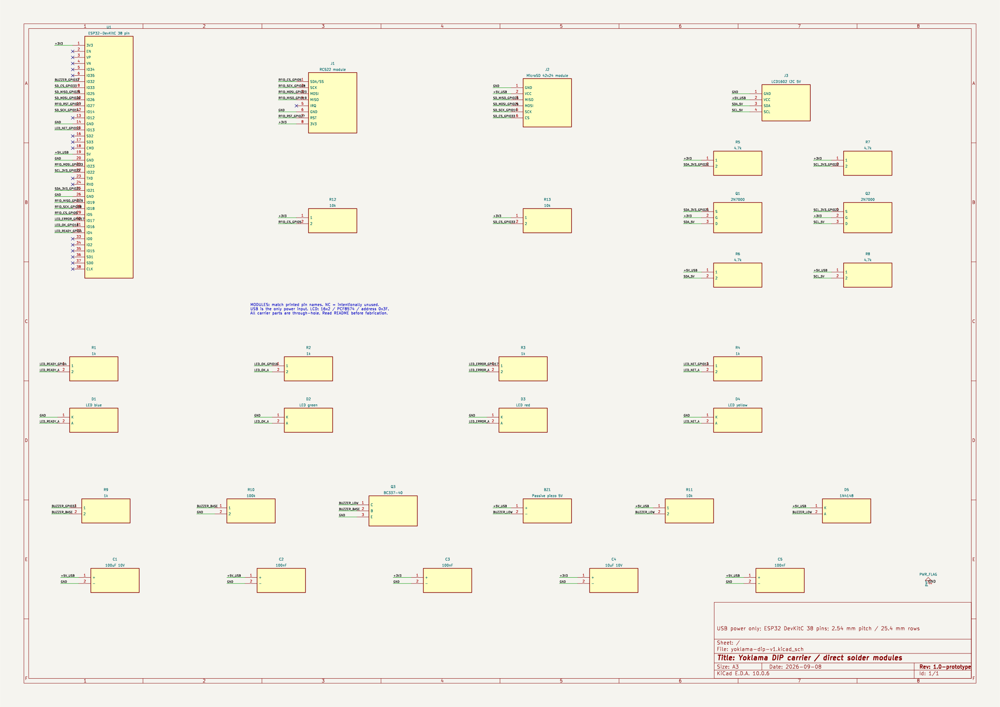
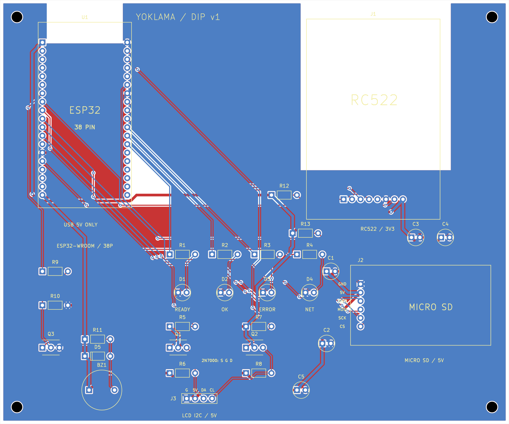
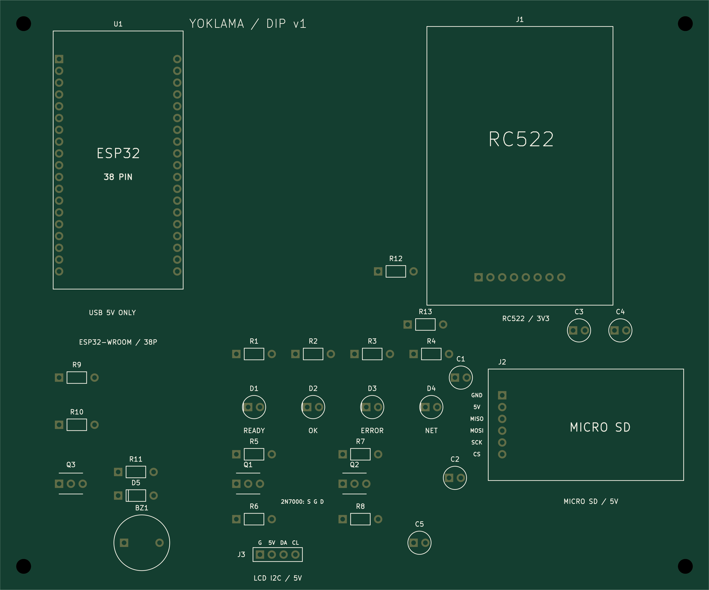

# Varlama — Card and Phone Attendance System

Varlama is an experimental attendance system designed for boarding houses, dormitories, hostels, and other managed facilities. It combines an ESP32 reader with an optional Android phone-card application so that authorized residents can record attendance without sharing personal identity data with the reader.

## Part 1 — ESP32 card reader and attendance panel

The ESP32 firmware reads RFID/MIFARE cards through an RC522 module, stores authorized credentials and attendance records on an SD card, and shows the latest result on an I2C LCD. A local web panel is served by the device for registering cards, managing residents, configuring Wi-Fi, and exporting attendance data as CSV.

The firmware can also operate as a Wi-Fi access point when an external network is unavailable. Attendance records are designed around a daily check-in model, preventing duplicate entries for the same person on the same day.

### Main hardware

- ESP32 development board
- RC522 RFID reader
- SD card module
- I2C LCD
- Optional Android phone with NFC host-card emulation

The pin mapping and PlatformIO dependencies are documented in `platformio.ini` and the source comments. Before deployment, set a strong local access-point password in `src/main.cpp` and configure the device through the web panel.

## Part 2 — Android phone-card application

The `android-phone-card/` module turns an NFC-capable Android phone into a reusable attendance card. The app stores a provisioned credential locally and exposes it through Android Host Card Emulation (HCE). An administrator can open the phone-provisioning mode on the ESP32, write a one-time credential to the phone, and then use the phone at the reader like a physical card.

The phone app is intentionally small: it provides a provisioning screen, secure local storage for the assigned credential, and an HCE service that responds only to the Varlama application protocol. It does not contain a server account or a hard-coded student list.

### Android setup

1. Open `android-phone-card/` in Android Studio.
2. Copy `master-key.properties.example` to `master-key.properties` only for local signing configuration.
3. Build and install the debug APK on an NFC-capable Android device.
4. Arm provisioning from the app, then use the ESP32 web panel to assign the phone.

Build output and signing files are intentionally ignored and are not part of this repository.

## Hardware design and schematics

The repository includes the current DIP/THT PCB design under [`hardware/dip-v1`](hardware/dip-v1). It contains the KiCad project, schematic, routed two-layer board, BOM, pinout, Gerber manufacturing files, verification reports, and exported drawings.

### Schematic preview

### Board and assembly previews

These drawings document the current prototype layout. They are not a substitute for checking the physical modules, USB power budget, antenna clearances, and first assembled prototype before manufacturing.

## Data and privacy notes

Use institution-specific identifiers instead of national ID numbers. Keep the ESP32 panel on a trusted local network, change all default credentials, and protect exported CSV files. This project is a prototype and has not been audited for production security or attendance-law compliance.
